<div align="center">

<a href="https://github.com/kukyos?tab=repositories"></a>


<a href="https://www.linkedin.com/in/armaansucks">linkedin</a> &nbsp;·&nbsp; <a href="mailto:amohamed@karunya.edu.in">email</a> &nbsp;·&nbsp; <a href="https://github.com/kukyos?tab=repositories">repos</a>

<br/>

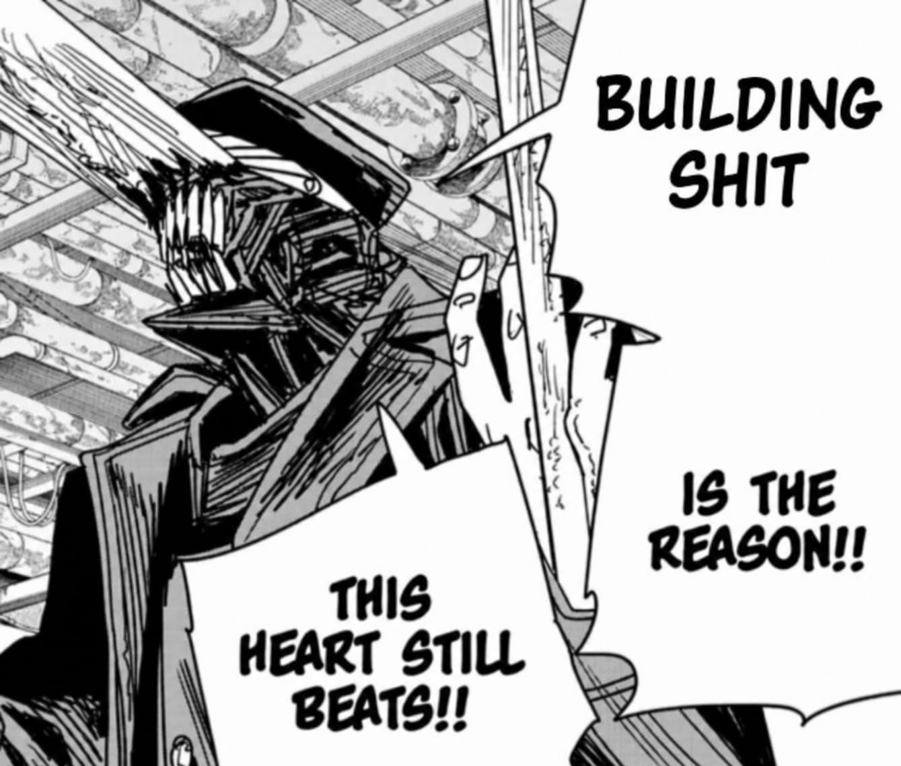

</div>

```
i build some tuff stuff.

now      agentic AI systems, simulation work, and slop websites
like     earning money, doing cool shit
built    client tooling for Blackstone Elevators
         a full hackathon platform, end to end
reach    amohamed@karunya.edu.in
```

<div align="center">

<sub>typescript · python · c · c++ · c# · javascript · larp</sub><br/>
<sub>react · next.js · tailwind · node · flask · fastapi · django · unity · postgres · vercel</sub><br/>
<sub><i>mostly claude though</i></sub>

<br/><br/>

<p></p>

<a href="https://github.com/kukyos/VVater"></a>
<a href="https://github.com/kukyos/Satelight"></a>
<a href="https://github.com/kukyos/AngelEyes"></a>
<a href="https://github.com/kukyos/Cuprum"></a>
<a href="https://github.com/kukyos/NullTicket"></a>
<a href="https://github.com/kukyos/AccessNull"></a>
<a href="https://github.com/kukyos/3bodyagents"></a>
<a href="https://github.com/kukyos/SoloLeveling"></a>
<a href="https://github.com/kukyos/LinkedAuto"></a>
<a href="https://github.com/kukyos/VisioNULLY"></a>
<a href="https://github.com/kukyos/NullDraw"></a>
<a href="https://github.com/kukyos/simathon"></a>
<a href="https://github.com/kukyos/Lancist"></a>
<a href="https://github.com/kukyos/Ecat"></a>

<sub>live &nbsp;→&nbsp; <a href="https://v-vater.vercel.app">vvater</a> · <a href="https://cuprum-gamma.vercel.app">cuprum</a> · <a href="https://nullticketing.vercel.app">nullticket</a> · <a href="https://new-access-null.vercel.app">accessnull</a> · <a href="https://3bodyagents.vercel.app">3bodyagents</a> · <a href="https://solo-leveling-two-beta.vercel.app">polymath os</a> · <a href="https://null-draw.vercel.app">nulldraw</a> · <a href="https://simathon.vercel.app">simathon</a> · <a href="https://ecat-one.vercel.app">ecat</a> · <a href="https://blackstoneforms.vercel.app">forms</a></sub>

<p></p>

<p></p>

<a href="https://github.com/kukyos/simathon-02-starsystem"></a>
<a href="https://github.com/kukyos/SingularityEngine"></a>
<a href="https://github.com/kukyos/GroundStateFinder"></a>
<a href="https://github.com/kukyos/fishschooling-sim"></a>
<a href="https://github.com/kukyos/Nozheimers"></a>

<sub>older &nbsp;→&nbsp; <a href="https://github.com/kukyos/NullChat">nullchat</a> · <a href="https://github.com/kukyos/GlobeTrotter">globetrotter</a> · <a href="https://github.com/kukyos/Synapse">synapse</a> · <a href="https://github.com/kukyos/ForeHeadDetector">foreheaddetector</a> · <a href="https://github.com/kukyos/GoofyAhhhSounds">goofyahhhsounds</a> · <a href="https://github.com/kukyos?tab=repositories">all 60+ repos</a></sub>

<p></p>

<p></p>


<sub></sub>

</div>
